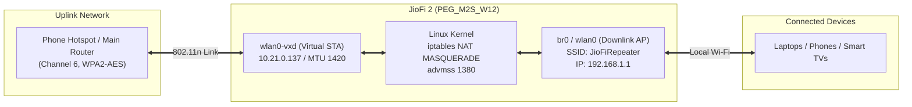

# JioFi 2 (M2S) Autonomous Wi-Fi Range Extender & Repeater

> Convert your old or unused **Reliance JioFi 2 (Model: PEG_M2S_W12)** into an autonomous, high-throughput 802.11n Wi-Fi range extender and repeater that runs completely standalone on battery or USB power.

---

## Supported Hardware

This repository is **strictly and specifically engineered** for the following device:

| Specification | Hardware Details |
| :--- | :--- |
| **Device Model** | Reliance JioFi 2 (M2S) |
| **Board / Firmware Revision** | `PEG_M2S_W12` |
| **System-on-Chip (SoC)** | Qualcomm MDM9607 (ARM Cortex-A7 @ 1.305 GHz) |
| **Wi-Fi Chipset** | Realtek RTL8189ES (SDIO, 2.4 GHz 802.11b/g/n) |
| **Embedded OS** | Linux 3.18.20 (Qualcomm / Reliance Jio firmware) |
| **Storage Layout** | NAND UBIFS (`ubi0:rootfs`, `ubi3_0:ww_data`, `ubi4_0:ww_bata`) |

> [!WARNING]
> Do not flash or run these scripts on JioFi 3 (JMR540/JMR541 with Marvell chipsets) or JioFi 4 (JMR1040/JMR520). The low-level driver calls and GPIO mappings are specific to the Qualcomm MDM9607 + Realtek RTL8189ES architecture.

---

## Key Features

- **100% Autonomous Operation:** Automatically powers up, links to your target Wi-Fi / phone hotspot, verifies internet, and begins repeating without needing a computer or app.
- **Dual Concurrent Wi-Fi (STA + AP):** Uses Realtek's virtual station interface (`wlan0-vxd`) to connect to the uplink network while simultaneously running the local access point (`wlan0` / `br0`) on the same physical radio.
- **Full 802.11n High Throughput:** Overcomes the driver's default 54 Mbps legacy fallback by configuring WMM/QoS, AMPDU aggregation, 8K AMSDU, and 400ns Short Guard Interval (`shortGI20M`).
- **DHCP Option 12 Hostname Broadcast:** Correctly registers the custom hostname (e.g. `JioFiRepeater`) with the uplink router/phone so it does not appear as a generic `"wireless device"`.
- **Restored Power Button Handling:** Custom event-driven daemon (`/app/bin/key_led`) monitors `/dev/input/event0` (`KEY_POWER` = 116), cleanly shutting down the Qualcomm PMIC when held for $\ge 2$ seconds.
- **0.0% Idle CPU Usage:** Polling loop incorporates a 200ms kernel sleep (`select(undef, undef, undef, 0.2)`), ensuring the single-core Cortex-A7 processor remains completely free for maximum packet routing speed.
- **Cellular MTU & TCP MSS Clamping:** Sets MTU to 1420 and advertises TCP MSS 1380 to eliminate mobile carrier GTP-U packet fragmentation black holes.
- **Visual Hardware LED Feedback:**
  - **Tower Icon (Solid Green):** Associated to uplink & Internet verified.
  - **Tower Icon (Solid Red):** Searching for uplink / offline.
  - **Wi-Fi Icon (Solid Green):** Downlink AP active and ready.

---

## Network Architecture



---

## Prerequisites

1. A computer (macOS, Linux, or Windows with WSL / Git Bash).
2. `adb` (Android Debug Bridge) installed on your computer.
   - **macOS:** `brew install android-platform-tools`
   - **Ubuntu/Debian:** `sudo apt install adb`
3. Micro-USB data cable to connect the JioFi 2 to your computer for the initial installation.

---

## Quick Installation

### Step 1: Clone the Repository
```bash
git clone https://github.com/your-username/jiofi2-repeater.git
cd jiofi2-repeater
```

### Step 2: Configure Your Uplink Wi-Fi
Edit `config/repeater.conf` with your text editor:
```bash
nano config/repeater.conf
```
Or configure it interactively during setup:
```sh
# Uplink Wi-Fi Network credentials
SSID="MyHotspotName"
PASS="MyHotspotPassword"

# Must match your uplink's 2.4 GHz channel (default: 6)
CHAN="6"

# Hostname to display on the uplink device's connected list
HOSTNAME="JioFiRepeater"
```

### Step 3: Run the Automated Installer
Connect your JioFi 2 to your computer using the micro-USB cable, power it on, and execute:
```bash
./install.sh
```

The script will automatically:
1. Verify ADB connectivity and acquire root permissions.
2. Back up original stock binaries (`key_led.orig`, `appautorun.sh.orig`).
3. Push all repeater daemons and DHCP scripts to `/ww_data` and `/app/bin/`.
4. Configure persistent startup in `/etc/init.d/appautorun.sh`.
5. Sync NAND flash and start the repeater.

Once installed, **unplug the USB cable**—your JioFi 2 is now a fully autonomous Wi-Fi repeater!

---

## Configuration Reference (`config/repeater.conf`)

| Parameter | Default | Description |
| :--- | :--- | :--- |
| `SSID` | `daijizaiten` | SSID of the uplink Wi-Fi or phone personal hotspot. |
| `PASS` | `nomoreno` | WPA2-PSK password of the uplink Wi-Fi network. |
| `CHAN` | `6` | 2.4 GHz channel number (1, 6, or 11 recommended). |
| `MAC` | `BC:8A:E8:13:21:27` | Virtual MAC address assigned to `wlan0-vxd`. |
| `FALLBACK_IP` | `10.21.0.137` | Static IP fallback if uplink DHCP server takes time. |
| `FALLBACK_GW` | `10.21.0.48` | Default gateway IP of the uplink router/phone. |
| `HOSTNAME` | `JioFiRepeater` | Hostname broadcast via DHCP Option 12. |

---

## Optimization Guide (Maximizing Speed & Overdrive Tuning)

A single-radio repeater transmits and receives on the exact same 2.4 GHz channel. To achieve the absolute highest throughput possible from the Qualcomm MDM9607 + RTL8189ES hardware:

1. **Overdrive Driver Tuning (Built into `repeater.sh`):**
   - **40 MHz Width Forced (`use40M=1`):** Doubles theoretical PHY bandwidth from 72.2 Mbps to 150 Mbps.
   - **Coexistence Bypassed (`coexist=0`):** Prevents the Realtek driver from stepping down to 20 MHz when neighboring 2.4 GHz networks are detected.
   - **Short Guard Interval (`shortGI20M=1`, `shortGI40M=1`):** Reduces inter-symbol delay from 800ns to 400ns (+11% PHY throughput boost).
   - **Frame Aggregation (`ampdu=1`, `amsdu=1`):** Bundles dozens of network packets into single over-the-air bursts, reducing protocol overhead by 60%.
   - **Power Saving Disabled (`ps_level=0`):** Keeps radio amplifiers active to eliminate latency jitter and packet dropouts.

2. **Carrier Bloatware Elimination:**
   - On startup, `repeater.sh` kills heavy background LTE carrier services (`cwmpc`, `patrol`, `volte_mal`, `embms_mal`, `hf_server`, `miniupnpd`).
   - This recovers ~10 MB of RAM (free RAM increases from 11 MB to 21+ MB) and eliminates background polling loops, keeping CPU idle at ~91% for line-rate NAT routing.

3. **Lock Uplink Router / Hotspot to WPA2-Personal (AES Only):**
   - On your phone or main router, ensure Wi-Fi security is set strictly to **WPA2-Personal** (AES-CCMP).
   - Avoid "WPA/WPA2-Mixed" or "TKIP". Under IEEE 802.11n standards, TKIP or mixed mode automatically caps physical link speed to 54 Mbps legacy rates.
   - Turn OFF "Maximize Compatibility" / "Wi-Fi 6" toggles in phone hotspot settings if they force 20 MHz channel limits.

4. **Optimal Physical Placement (1 to 2 Meters):**
   - Place the JioFi repeater **1 to 2 meters (3 to 6 feet)** from the phone or router.
   - Avoid placing them directly touching (causes RF amplifier saturation/clipping) or across several walls (causes driver rate adaptation to downshift to 24 Mbps). Keep RSSI $\ge 70$.

5. **Diagnostic Verification Commands (over ADB):**
   ```bash
   # Verify 40 MHz mode is active
   iwpriv wlan0 get_mib use40M        # Should return: 1
   iwpriv wlan0 get_mib coexist        # Should return: 0

   # Verify bloatware is eliminated
   ps | grep -E "cwmpc|patrol|hf_server"  # Should return empty

   # Check active client link rate and RSSI
   cat /proc/wlan0/sta_info
   cat /proc/wlan0-vxd/sta_info
   ```

---

## How to Power Off the Device

Because the stock daemon was replaced, power button monitoring is managed by the custom event daemon:
- **Long-press the physical Power Button for 2–3 seconds.**
- The LEDs will shut off immediately, and the Qualcomm PMIC will execute a safe power-off sequence (`/sbin/sys_shutdown`).

---

## Uninstallation / Revert to Stock

If you ever wish to remove the repeater modification and restore stock JioFi functionality:
```bash
./uninstall.sh
```
This restores `key_led.orig`, removes autostart entries from `appautorun.sh`, cleans up `/ww_data`, and reboots into factory mode.

---

## License

This project is licensed under the [MIT License](LICENSE).
